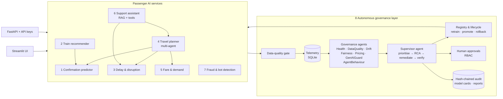

# 🚆 RailMind AI
### AI-Powered Intelligent Railway Travel & Autonomous AI Governance Platform

RailMind AI is an end-to-end platform with two halves that work as one system:

1. **Seven passenger-facing AI services** — WL/RAC confirmation prediction, personalised train recommendations, delay & disruption forecasting, a multi-agent travel planner, dynamic fare forecasting, a multilingual support assistant, and fraud/bot detection.
2. **An autonomous "AI-for-AI" governance layer** — specialist governance agents that continuously monitor every model and agent (health, SLA, data quality, drift, bias, hallucinations, pricing anomalies, agent behaviour), a supervisor agent that prioritises alerts, runs root-cause analysis, remediates (retrain → champion/challenger → promote, rollback, quarantine, circuit-breaker), verifies the fix on fresh traffic, and escalates to humans when policy requires — all recorded in a tamper-evident audit trail.

It runs fully **offline on a laptop with no API keys**. An LLM (Gemini, OpenAI, Claude or a local Ollama model) can optionally be plugged in; every generated word still passes the hallucination guard.

> All train timetables, bookings, delays, fares and sessions are **synthetic**, generated with realistic structure (festival peaks, monsoon/fog seasons, flexi fares, Tatkal, bot behaviour). Station codes and coordinates are real.

---

## Contents
- [Quick start](#quick-start)
- [What maps to which requirement](#requirement-coverage)
- [Architecture](#architecture)
- [5-minute demo script](#5-minute-demo-script)
- [The governance layer in detail](#the-autonomous-governance-layer)
- [REST API](#rest-api)
- [Project structure](#project-structure)
- [Non-functional requirements](#non-functional-requirements)
- [Limitations & next steps](#limitations--next-steps)

---

## Quick start

**Requirements:** Python 3.10 – 3.13.

```bash
git clone <your-repo-url> railmind-ai && cd railmind-ai
python -m venv .venv && source .venv/bin/activate      # Windows: .venv\Scripts\activate
pip install -r requirements.txt

python scripts/train_all.py        # generates synthetic data + trains & registers all models (~45 s)
streamlit run app/Home.py          # UI  → http://localhost:8501
uvicorn api.main:app --reload      # API → http://localhost:8000/docs   (optional, separate terminal)
pytest -q                          # 21 tests: models, agents, governance loop, API, RBAC
```

Or with Docker: `docker build -t railmind . && docker run -p 8501:8501 -p 8000:8000 railmind`

**Optional LLM** (copy `.env.example` → `.env` or export):
```bash
export RAILMIND_LLM=gemini        # or openai | anthropic | ollama
export GEMINI_API_KEY=...          # matching key; Ollama needs none
```

---

## Requirement coverage

| # | Requirement | Implementation | Key techniques |
|---|---|---|---|
| 1 | **Ticket confirmation predictor** | `railmind/passenger/confirmation.py` · UI page 1 | Gradient-boosted classifier (AUC ≈ 0.99 on holdout); multi-class CNF/RAC/WL final-status model; calibrated confidence from reliability bins; per-prediction attributions; historical trend analysis; auto-retrain on Brier-score degradation |
| 2 | **Smart train recommender** | `passenger/recommender.py` · page 2 | Learning-to-rank on 9,000 historical choice sessions (Hit@1 0.51 vs 0.30 cheapest-first baseline); budget, duration, availability (via #1), class, punctuality, travel history (leakage-safe affinity), preferences; natural-language rationale per pick; fairness audit by gender/region |
| 3 | **Delay & disruption prediction** | `passenger/delay.py` · page 3 | Point + quantile (P10/P90) models → 80 % interval, on-time probability; station-congestion model; proactive alerts; alternative trains; explainability report |
| 4 | **AI travel planner agent** | `passenger/planner.py` · page 4 | Multi-agent orchestration: Intent → Search (direct + 1-change) → Availability → Delay → Fare → Optimizer → **Validator**; English + Hinglish NLU; risk-adjusted arrival; Tatkal advice; booking only with an approval token; full tool-call trace; behaviour anomaly detection |
| 5 | **Dynamic fare prediction** | `passenger/fare.py` · page 5 | Fare model over flexi/Tatkal pricing; occupancy-curve forecast → fare curve with bands; optimal booking day; demand-surge forecast (MAPE reported); pricing anomaly detection (policy bounds + Isolation Forest) |
| 6 | **Customer support assistant** | `passenger/support.py`, `knowledge/kb.json` · page 6 | Multilingual (English, हिन्दी, বাংলা, Hinglish) RAG + tools (PNR, refund, delay, planner); grounding/numeric/entity/policy hallucination guard; response-quality score; CSAT (predicted + thumbs feedback); PII-masked conversation audit |
| 7 | **Fraud, security & bot detection** | `passenger/fraud.py` · page 7 | Hybrid score = supervised GBM + Isolation Forest + explainable rules; ALLOW / REVIEW / BLOCK; FP/FN monitoring; auto-retrain on new attack patterns; threshold changes need human approval |
| 8 | **Centralised AI governance** | `railmind/governance/*` · pages 8–10 | See below |

| Governance capability | Where |
|---|---|
| Model health, SLA, service health, resource utilisation | `governance/monitoring.py` |
| Data validation **before** inference; blocks bad data | `governance/data_quality.py` (gate inside every `infer()`) |
| Data drift (PSI, KS, χ²), concept drift (labelled performance + Page-Hinkley), prediction drift, user-behaviour shift | `governance/drift.py` |
| Fairness (parity, equal opportunity, FPR parity, error parity), ethical-AI checklist | `governance/fairness.py` |
| Hallucination monitoring for GenAI | `governance/hallucination.py` |
| Autonomous root-cause analysis over a dependency graph | `governance/rca.py` |
| Retraining triggers, versioning, champion/challenger, promotion, rollback | `governance/registry.py`, `governance/lifecycle.py` |
| Explainability, model cards, governance reports, audit trail | `explain.py`, `governance/reports.py`, `governance/store.py` |
| Agentic supervisory layer, alert prioritisation, closed-loop remediation, human approvals | `governance/supervisor.py` |
| Agent validation, audit trails, abnormal-behaviour detection | `passenger/planner.py` (ValidatorAgent), `governance/agent_monitor.py` |
| Role-based access control, privacy | `railmind/security.py`, PII masking in `governance/store.py` |

---

## Architecture



**Every prediction path** goes: request → data-quality gate (block if score < 0.70 or a hard constraint fails) → production model from the registry → explanation → telemetry (latency, quality score, prediction, later the ground-truth label) → audit.

**The governance loop** (one *cycle*):
1. Seven specialist agents inspect the look-back window and emit findings.
2. The supervisor scores each finding: `severity × model criticality × confidence × (1 + 0.1 × blast radius)`.
3. Findings are grouped per model and passed to RCA, which walks the dependency graph (data feeds → features → models → consumers) and ranks hypotheses: data-pipeline fault, covariate drift, concept drift, bad deployment, infrastructure, GenAI hallucination, pricing logic, agent behaviour, new threat pattern, fairness.
4. Each hypothesis maps to a playbook action. Policy (`config.AUTO_REMEDIATION`) decides whether it runs autonomously or is queued for a Governance Officer.
5. Retraining is champion/challenger: the challenger must beat the champion on recent labelled data **and** not regress on the original reference data.
6. The fix is verified on fresh post-remediation traffic. After a regime change (e.g. monsoon), the new model is judged against the old one on the *same* traffic.
7. Incident, actions and verification are written to the hash-chained audit log and a Markdown governance report.

---

## 5-minute demo script

1. **Home** — architecture and live service health.
2. **Travel Planner Agent** — run the flagship query *"I want to travel from Pune to Delhi tomorrow under ₹1500 and reach before 10:00 AM."* Show the parsed constraints, the recommended train (fare ≤ ₹1500, arrival before 10:00 even after the predicted delay), the rejected options with reasons, the agent trace, the validator pill — then **Approve & book**.
3. **Ticket Confirmation** — a WL ticket: probability, expected final status, confidence, and *why*.
4. **Support Assistant** — ask in Hindi *"तत्काल बुकिंग कब खुलती है?"* and in Bengali; note the grounding and quality pills.
5. **Autonomous Ops** (role *Administrator*):
   - *Seed 24 h of healthy history* → *Generate live traffic* → *Run governance cycle* → no findings.
   - Toggle **monsoon drift**, **LLM hallucination**, **pricing bug** (and any others) → *Generate live traffic* → *Run governance cycle*.
   - Watch prioritised alerts, RCA hypotheses, autonomous retrain/promotion, release revert, KB refresh and verification. Fraud threshold changes and fairness questions appear under **Human-in-the-loop approvals**.
   - *Clear all faults* → traffic → cycle again: if a drift-adapted model is now worse than its predecessor, the supervisor rolls it back (regime reverted). *Reset demo* restores every model to v1.
6. **Governance Command Center** — SLA table, drift PSI chart, fairness tables, GenAI quality by language, model lineage (v1 → v2 with reason), agent oversight.
7. **Audit & Compliance** — hash chain intact, model cards with ethical-AI controls, RBAC matrix, PII masking demo, downloadable reports. Switch the sidebar role to *Passenger* to see RBAC block governance pages.

### Failure scenarios you can inject

| Scenario | What breaks | What the governance layer does |
|---|---|---|
| `monsoon_drift` | Weather/congestion shift, delays grow | DriftAgent: PSI + MAE degradation → RCA *covariate drift* → retrain → promote v2 → verified vs v1 on same traffic |
| `festival_surge` | Cancellations collapse during Diwali-like rush | Accuracy/Brier degradation → retrain (Brier-scored champion/challenger) |
| `bot_attack` | Human-mimicking bot farm | Fraud recall drops → *new threat pattern* → retrain + **approval request** to lower review threshold |
| `corrupt_feed` | Nulls & negative delays from NTES feed | Gate blocks bad records → *data pipeline* → quarantine + failover |
| `llm_hallucination` | Generator invents fares, guarantees berths | Guard blocks every unsafe answer → *GenAI hallucination* → disable free-form generation, re-index KB |
| `pricing_bug` | Quotes above the flexi-fare cap | PricingAgent → *pricing logic* → revert release, clamp to policy |
| `latency_spike` | p95 > 250 ms SLA | HealthAgent → *infrastructure* → scale out |
| `agent_loop` | Planner loops on tool calls | AgentBehaviourAgent → *agent behaviour* → circuit breaker |

---

## The autonomous governance layer

* **Registry & lineage** — every model/agent version stores metrics, parameters, training-data fingerprint, parent version, reason and model card; promotions and rollbacks are recorded with actor and reason.
* **GenAI components are versioned too** — the support assistant (knowledge-base hash, retriever, languages, guard) and the planner agent (sub-agents, tool budget, approval policy) are registered like models.
* **Data quality** — missing, wrong-type, unseen-category, physically impossible (hard constraints) and statistically anomalous values produce a 0–1 score; inference is refused below 0.70.
* **Drift** — PSI per feature on training-profile bins, KS / χ² tests, prediction-distribution PSI, labelled performance vs the registered baseline, and a Page-Hinkley detector on the error stream.
* **Fairness** — confirmation errors for non-AC vs AC passengers (socio-economic proxy), fraud false-positive rates for new vs established accounts, delay error by railway zone, support quality by language, recommender quality and premium-train exposure by gender/region. No protected attribute is ever a model feature (checked automatically).
* **Hallucination guard** — sentence-level grounding against retrieved evidence (character n-gram similarity, robust across scripts), every number must appear in evidence, train numbers/PNRs must come from tool results, and policy checks (no OTP requests, no confirmation guarantees). Unsafe drafts are never shown.
* **Audit** — append-only log where each record carries the SHA-256 of its predecessor; `verify_audit_chain()` pinpoints any edited or deleted record. PII (phones, e-mail, Aadhaar-like IDs, card numbers) is masked before persistence.
* **RBAC** — five roles (Passenger, Operations Analyst, ML Engineer, Governance Officer, Administrator) enforced in the UI and the API (`X-API-Key`).

---

## REST API

Interactive docs at `http://localhost:8000/docs`. Demo keys live in `railmind/security.py` (override with `RAILMIND_API_KEYS`).

```bash
curl -s localhost:8000/v1/planner/plan -H "X-API-Key: passenger-demo-key" -H "Content-Type: application/json" \
  -d '{"query":"I want to travel from Pune to Delhi tomorrow under ₹1500 and reach before 10:00 AM."}'

curl -s localhost:8000/v1/support/chat -H "X-API-Key: passenger-demo-key" -H "Content-Type: application/json" \
  -d '{"message":"What is the cancellation charge for sleeper class?"}'

curl -s -X POST "localhost:8000/v1/governance/faults/monsoon_drift?on=true" -H "X-API-Key: mlops-demo-key"
curl -s -X POST localhost:8000/v1/governance/traffic -H "X-API-Key: mlops-demo-key"
curl -s -X POST localhost:8000/v1/governance/cycle   -H "X-API-Key: mlops-demo-key"
```

| Endpoint | Permission |
|---|---|
| `POST /v1/confirmation/predict`, `/v1/recommendations`, `/v1/delay/predict`, `/v1/fares/forecast`, `/v1/planner/plan`, `/v1/planner/book`, `/v1/support/chat` | passenger |
| `POST /v1/fraud/score` | ops.view |
| `GET /v1/governance/health`, `/models`, `/alerts`, `/approvals` | governance.view |
| `POST /v1/governance/faults/{name}`, `/traffic`, `/cycle` | governance.act |
| `POST /v1/governance/approvals/{id}` | approve |
| `GET /v1/governance/audit` | audit |

---

## Project structure

```
railmind-ai/
├── app/                       Streamlit UI (Home + 10 pages)
├── api/main.py                FastAPI service with RBAC
├── railmind/
│   ├── config.py              paths, SLAs, governance thresholds, remediation policy
│   ├── reference.py           stations, classes, fare rules, festival calendar
│   ├── datagen.py             synthetic data generator (10 datasets)
│   ├── data.py, inventory.py  data access, seat availability, booking ledger
│   ├── explain.py             local & global explainability
│   ├── llm.py                 optional LLM connector (Gemini/OpenAI/Claude/Ollama)
│   ├── security.py            roles, permissions, API keys
│   ├── faults.py              failure-scenario switches
│   ├── knowledge/kb.json      multilingual policy knowledge base
│   ├── passenger/             the 7 AI services (+ shared governed base class)
│   └── governance/            store, registry, data_quality, drift, fairness, hallucination,
│                              monitoring, rca, lifecycle, agent_monitor, supervisor, simulator, reports
├── scripts/train_all.py       data generation + training + registration
├── tests/                     pytest suite
├── docs/architecture.md       design notes and production deployment path
├── Dockerfile, requirements.txt, .github/workflows/ci.yml
```

---

## Non-functional requirements

| NFR | In this repository | Production path |
|---|---|---|
| **Scalability** | Stateless services, models loaded once and cached, vectorised batch scoring | Containerised services behind an autoscaler (Kubernetes HPA); Kafka for telemetry; feature store; model server (e.g. KServe) |
| **Reliability** | Data-quality gate, graceful LLM fallback, champion/challenger with rollback, verification after every fix | Multi-zone replicas, blue/green model rollout, DR replica of registry and audit store |
| **Security** | RBAC in UI + API, approval tokens for bookings, PII masking, fraud/bot detection, access-denied events audited | SSO/OAuth, secrets manager, WAF, encryption at rest/in transit |
| **Compliance** | Model cards, ethical-AI checklist, explanations, hash-chained audit, governance reports | Immutable ledger (WORM storage), periodic audit exports, DPDP Act 2023 alignment review |
| **Performance** | Single prediction incl. explanation ≈ 20–60 ms; p95 tracked against a 250 ms SLA | GPU/CPU pools per model, response caching, async explanation generation |

---

## Limitations & next steps

* Data is synthetic; models must be recalibrated on real PRS/NTES/CRIS data before any real-world use. Policy text in the knowledge base summarises Indian Railways rules for demonstration — always confirm on official channels.
* Weather is a seasonal default (overridable); production should consume an IMD feed.
* The simulator stands in for production traffic and delayed ground-truth labels.
* Next: online learning for delay models, causal uplift for booking-window advice, LLM-as-judge evaluation for support quality, and a Kafka/Feast deployment.

---

*Built by Mousumi Dasgupta — MBA (AI & Data Science), T. A. Pai Management Institute, Manipal.*
